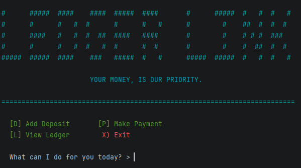

# Accounting Ledger

<!-- HOW TO USE THIS TEMPLATE
     Save it as README.md at the root of your project, next to pom.xml. Replace every comment like this one
     with your own text; comments do not show on GitHub, so what you leave untouched shows as an empty heading.
     Two sections are optional and say so: Class Diagram, and Data and configuration. When your project does not
     need one, delete the whole section, heading included. Every other section stays. -->

<!-- One sentence under the title: what the app is, for whom.
     Example: A console app that keeps a store's inventory in a csv file and lets a clerk search it. -->

## Application that helps users track deposits and payments. Transactions are saved to a CSV file so they remain available after restarting the program.

<!-- Three to five sentences. What the application does, who uses it, what problem it solves.
     Write it for someone who has never seen the workbook: a recruiter, a classmate, you in six months. -->


## Features

<!-- One bullet per thing the app can do, in the order of your menu. Mark bonuses.
     For an API (Capstone 3), one line per endpoint instead: method, path, what it does.
     Be honest: list what works. If something is half done, say so under Future Work instead.
     Example:
     - Shows every product in the store
     - Searches products by name (bonus) -->

- Adding Deposits
- Make Payments
- View for ledger with many different ways to sort transactions seen

## User Stories

<!-- The stories you worked from, one per bullet, in the format you learned in Workbook 3b:
     As a [type of user], I want [some goal] so that [some reason].
     Same text as the cards on your GitHub project board. -->

- As a user, I want to record deposits so that I can track incomang money.
- As a user, I want to record payments so that I can track spending.
- As a user, I want my transactions saved to the file so that I can access them after restarting .
- As a user, I want to view all transactions from newest to oldest so for recent activty first.
- As a user, I want to view deposits and payments separately.
- As a user, I want to filter transactions for specific periods.
- As a user, I want to filter transactions by vendor when looking fro particular business or person.

## Setup

### Prerequisites

- Java 17 (Amazon Corretto), the version used in class.
- IntelliJ IDEA Community Edition: <https://www.jetbrains.com/idea/download/>


### Running the application

1. Clone this repository, or download it as a zip and unzip it.
2. In IntelliJ: File > Open, pick the project folder (the one that holds `pom.xml`), press Open.
3. Wait for IntelliJ to finish indexing (progress bar at the bottom).
4. Open `src/main/java/com/pluralsight/YourMainClassName.java`. <!-- replace YourMainClassName with the class that has main -->
5. Right-click inside the file and choose Run 'YourMainClassName.main()'.

### Data and configuration

<!-- OPTIONAL. Anything the program needs that is not code: data files and where they must sit, files the
     program creates, a database script to run first, a settings file to edit (connection, port).
     If there is nothing, delete this subsection, heading included.
     Example:
     - `inventory.csv` sits at the project root, next to `pom.xml`. The program reads it at start.
     - `logs.txt` is created by the program at the project root on the first run. -->

- transactions.csv belongs in the project root, next to pom.xml. Will be read by program at Start.
## Technologies Used

- Java 17
- IntelliJ IDEA
<!-- Add anything else you used: a library, Maven plugins, an external tool. For a console app this list is short. That is fine. -->

## Demo

<!-- Pictures of the app running: the console for a console app, Insomnia or Swagger for an API.
     Screenshots are enough; a GIF is a bonus.
     1. Create a folder named `images` at the project root, next to `pom.xml`.
     2. Take screenshots of the app in the IntelliJ console (the menu, one feature, one error message):
          Windows: Win + Shift + S, drag a rectangle, then paste into Paint and save as PNG, or open the
                   notification and save. Save into the `images` folder.
          Mac:     Shift + Cmd + 4, drag a rectangle. The file lands on the Desktop; move it into `images`.
     3. Name the files by what they show: `images/menu.png`, `images/search.png`.
     4. Reference each one below with a relative path. No spaces in file names.
     5. Commit the images with the rest of your work (Git > Commit shows them as unversioned files: tick them).
     Optional GIF: LICEcap (free, Windows and Mac, <https://www.cockos.com/licecap/>) records a region of the
     screen straight to a .gif. Keep it under 10 seconds and under 10 MB, save it into `images`. -->




## A piece of code I am proud of

<!-- Paste one short block of your own code (5 to 15 lines) between the three backticks, then write two
     or three sentences: what it does and why you chose to write it that way. This is what you show on
     demo day and what you talk about in an interview. -->

```java
  private static void showProgress(String title, int completedSteps) {
        // Lists the steps in the order they are completed
        String[] steps = {"Date", "Time", "Description", "Vendor", "Amount", "Saved"};

        System.out.println("|----------------------------|");
        System.out.printf("| %-26s |%n", title); //Title is either Addpayment or add deposit
        //-26 Gives a min width so the box line sup

        for (int i = 0; i < steps.length; i++) {
            if (i < completedSteps) { // Checks whether this step is completed
                System.out.print("\u001B[32m"); // Changes completed steps to green
                System.out.printf("| [X] %-22s |%n", steps[i]);
                System.out.print("\u001B[0m"); 
            } else {
                System.out.printf("| [ ] %-22s |%n", steps[i]); //Keeps blank since not filled yet
            }
        }

        System.out.println("+----------------------------+");
    }

```
- This method is a checkbox when going threw the process of adding a Payment or deposit.
- It uses the array steps and int completedsteps to go threw 1 at a time and check if an answer had been put in for the question then adds a X/ check next to it and turn the text color green

## Future Work

<!-- What you would add or fix next, one bullet each. Unfinished bonuses belong here. -->

- I would like to add animation
- I would like to add some sort of color or design

## Resources

<!-- What helped you: the workbook, the week's hub pages, a tutorial, a documentation page. Real links. -->

- Java YearUp Fall 2026 hub: <https://raymaroun.github.io/yearup-java-fall2026/>
- https://gsapify.com/gsap-animations/
- https://codefronts.com/components/

## Author

<!-- Your name and, if you like, your GitHub profile link. For a team workshop, one line per person with what each one built. -->

- **Isaiah Covington**
